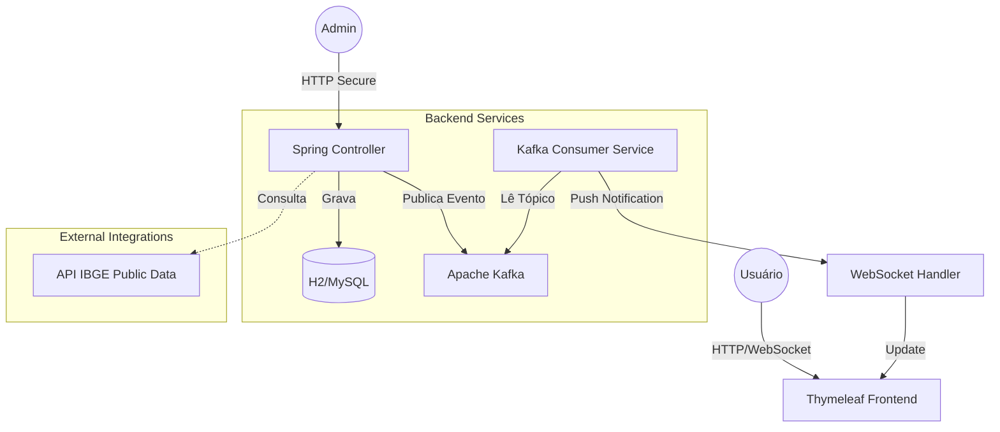

# AutoGrid - Distributed Vehicle Catalog System


O **AutoGrid** é um sistema de gerenciamento de catálogo veicular projetado com arquitetura orientada a eventos. O foco do projeto é demonstrar a implementação de **notificações em tempo real** e **segurança robusta** em um ambiente distribuído.

Diferente de um CRUD tradicional, este projeto desacopla o registro do veículo da notificação ao usuário utilizando **Apache Kafka**, garantindo que o sistema de cadastro permaneça responsivo mesmo sob alta carga.

---

## 🏗 Arquitetura do Sistema

O sistema segue uma arquitetura em camadas, utilizando mensageria para comunicação assíncrona entre o módulo de administração e a interface pública.



## 🛠 Tecnologias e Decisões Técnicas

### Backend & Arquitetura

* **Java 21 & Spring Boot 3:** Utilizados pela robustez e ecossistema maduro.
* **Apache Kafka:** Escolhido para desacoplar o processo de "Cadastro" do processo de "Notificação". Isso permite que, no futuro, novos microsserviços (ex: envio de emails de marketing) consumam o mesmo evento sem alterar o código do cadastro.
* **WebSockets (STOMP):** Permite que o cliente receba notificações em tempo real. 
* **Spring Security:** Implementação de autenticação Stateful (Session-based) para proteger as rotas administrativas `/admin/**`.

### DevOps & Infraestrutura

* **Docker & Docker Compose:** O Kafka é orquestrado via contêiner para garantir que o ambiente de desenvolvimento seja idêntico em qualquer máquina, eliminando o problema de "funciona na minha máquina".

---

## ✨ Funcionalidades Principais

### 1. Event-Driven Notification System

Ao cadastrar um veículo, o sistema não apenas salva no banco:

1. O veículo é persistido no banco de dados.
2. Um evento `SendMessageCarro` é publicado no tópico `added-new-car` do Kafka.
3. Um listener assíncrono consome este evento e dispara um alerta via WebSocket para todos os clientes conectados.
*Resultado:* O usuário final vê a notificação do novo carro aparecer na tela em milissegundos.

### 2. Integração com Dados Governamentais (IBGE)

Para garantir a integridade dos dados de localização, o sistema consome a API de dados públicos do IBGE durante o cadastro, evitando erros de digitação em estados e cidades.

### 3. Painel Administrativo Seguro

* Acesso restrito via Spring Security.
* CRUD completo com validações de Bean Validation.

---

## 📸 Screenshots


---

## ⚙️ Como Executar Localmente

### Pré-requisitos

* Java JDK 21
* Docker & Docker Compose

### Passo a Passo

1. **Clone o repositório:**
```bash
git clone https://github.com/agsjohn/AutoGrid_WebSite.git
cd AutoGrid_WebSite

```


2. **Suba a infraestrutura (Kafka):**
```bash
docker-compose up -d

```


*Aguarde alguns segundos para o Kafka estabilizar.*
3. **Execute a aplicação:**
```bash
./gradlew bootRun

```


4. **Acesse:**
* Vitrine: `http://localhost:8080`
* Admin: `http://localhost:8080/painel` (User: `admin` / Pass: `admin123`)


---

## 👨‍💻 Autor

**João Vitor M.**

* [LinkedIn](https://www.linkedin.com/in/joaovitormds)
* [Portfólio](https://agsjohn.github.io/)
